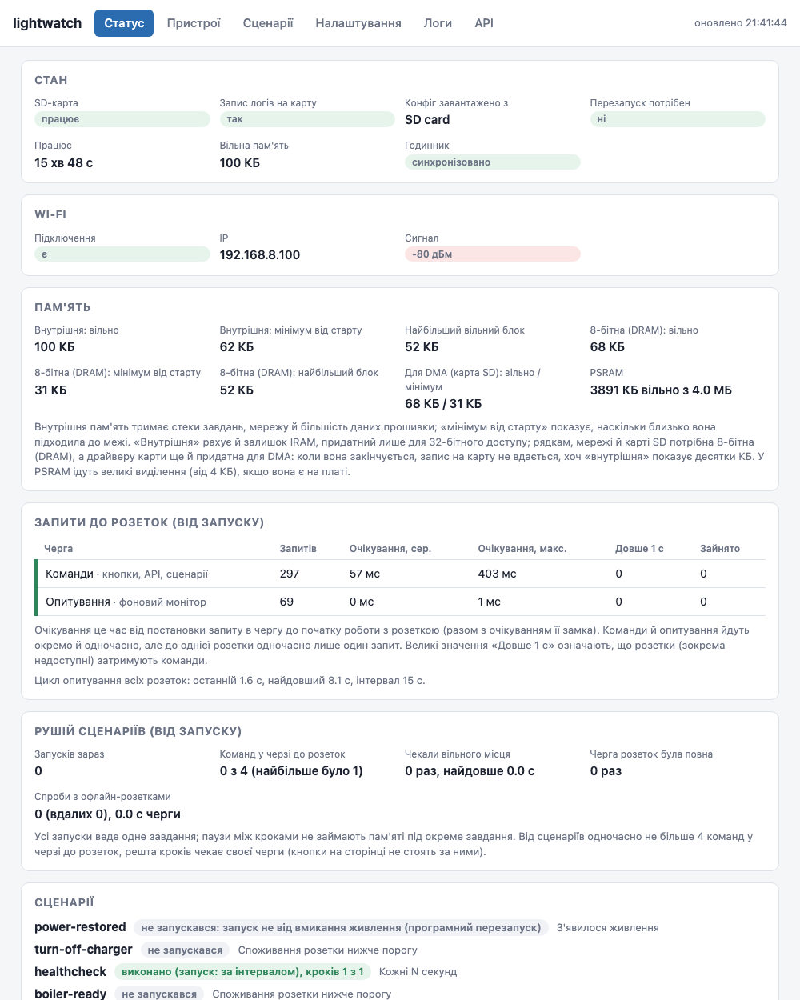
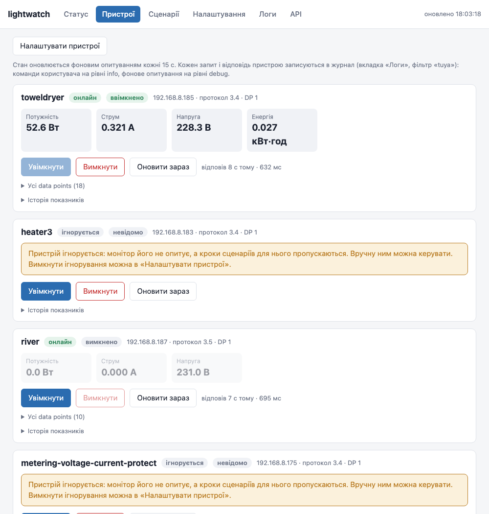
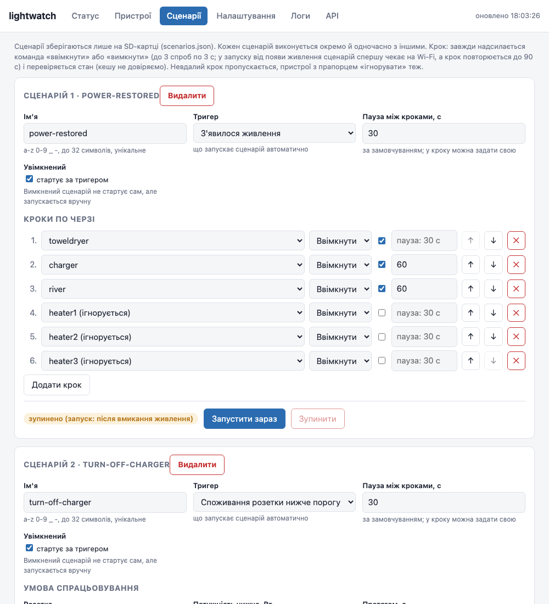
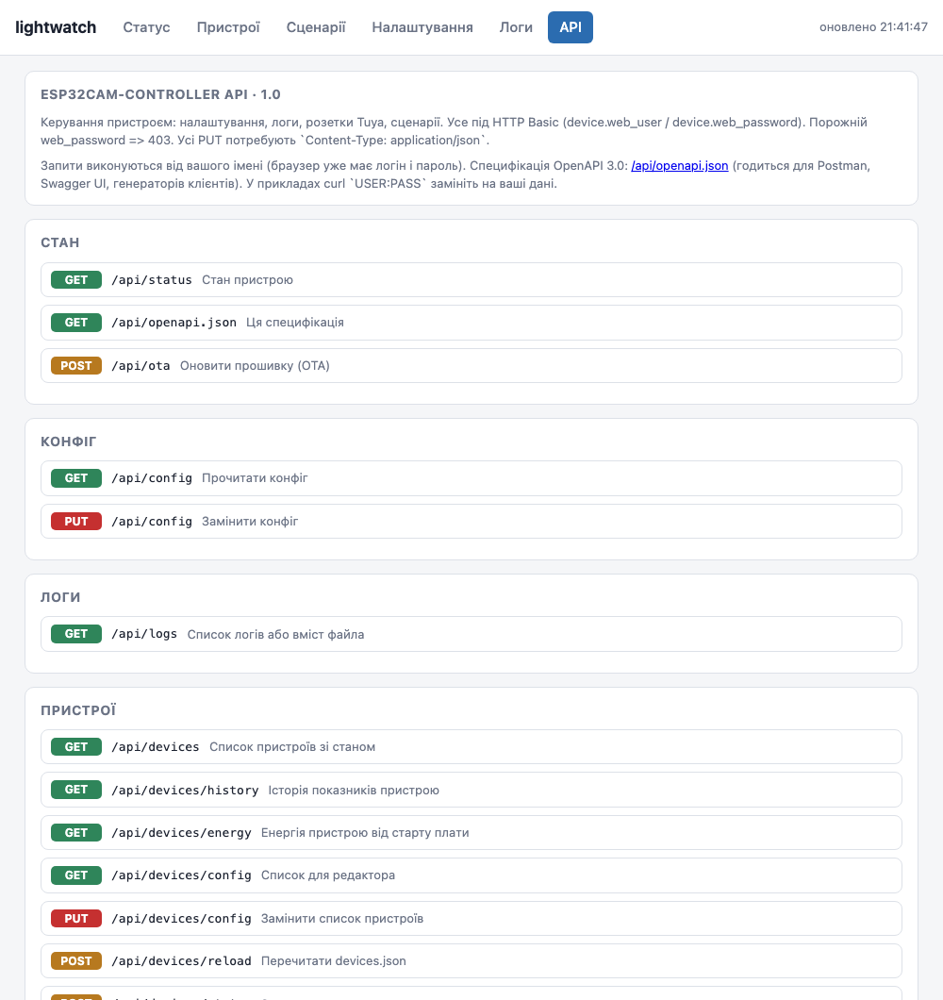

# lightwatch-esp-cam

Автономний контролер на ESP32-CAM для розеток Tuya. Після відключення світла він стартує сам, підключається до Wi-Fi і
по локальній мережі (без хмари) вмикає розетки за сценаріями. Камера не використовується.

- опитує й перемикає розетки Tuya по локальному протоколу 3.4 і 3.5, показує потужність, струм, напругу й енергію;
- виконує сценарії: «з'явилося живлення», вручну, споживання розетки нижче чи вище порогу;
- має веб-інтерфейс і JSON API з описом OpenAPI, усе вбудоване в прошивку й працює без інтернету;
- зберігає налаштування й логи на SD-карті, а копію конфіга ще й у флеші, тож працює і без карти;
- переживає різкі відключення живлення: атомарний запис файлів, історія останніх 16 запусків.

| Статус | Пристрої |
|---|---|
|  |  |
| **Сценарії** | **API** |
|  |  |

## Залізо

| Що | Примітка |
|---|---|
| ESP32-CAM (AI-Thinker) | модуль із 4 МБ флеша |
| microSD, FAT32 | для конфігів і логів; без неї пристрій теж працює |
| Живлення 5 В, ≥ 1 А | стабілізоване, на піни `5V` і `GND` модуля |
| ESP32-CAM-MB | лише для прошивання й налагодження |

> **Не залишайте модуль на MB для автономної роботи.** З MB (CH340, лінії DTR/RTS на EN і GPIO0) програма після простого
> вмикання живлення часто не стартує, доки не натиснути RST або не відкрити серійний порт. Для роботи подайте 5 В
> напряму на `5V` і `GND`, GPIO0 нікуди не підключайте. Нову прошивку можна залити по Wi-Fi (OTA, див. нижче), MB
> потрібна лише для першої прошивки чи аварії.

## Початок роботи

### Збірка й прошивка

Потрібен [PlatformIO](https://platformio.org/) (платформа pioarduino з Arduino core 3.3.x, плата `esp32cam`, розмітка
`min_spiffs.csv`).

```bash
pio run -t upload        # модуль має стояти на MB
pio device monitor       # 115200; відкриття порту скидає плату
```

Далі по Wi-Fi (OTA): вкладка «Налаштування» → «Прошивка» → файл `.pio/build/esp32cam/firmware.bin`, або

```bash
curl -u admin:PASS -H "Content-Type: application/octet-stream" -H "X-OTA-Confirm: 1" --data-binary @.pio/build/esp32cam/firmware.bin http://IP/api/ota
```

Образ пишеться в інший слот, поки працює поточна прошивка; після перезапуску нова має пропрацювати 60 с з Wi-Fi, інакше
завантажувач повертає попередню. Перезапуск програмний: сценарій «З'явилося живлення» не стартує.

### SD-карта

1. Відформатуйте карту у FAT32 (не exFAT).
2. Скопіюйте `sdcard/config.json` у корінь карти.
3. Задайте `wifi.ssid`, `wifi.password` і **обов'язково** `device.web_password`: поки він порожній, API й сторінка відповідають 403.

### Перший запуск

1. Відкрийте `http://<IP пристрою>/` (логін і пароль із `device.web_user` / `device.web_password`).
2. На вкладці «Пристрої» → «Налаштувати пристрої» додайте розетки: ім'я, IP, local key (його дає
   [TinyTuya](https://github.com/jasonacox/tinytuya) `wizard`), версія протоколу. Ключі зберігаються в `devices.json` на
   карті й ніколи не віддаються назад.
3. На вкладці «Сценарії» створіть сценарії.

Скидання плати (прошивання, RST, відкриття серійного порту) ESP32 рахує як вмикання живлення, тож увімкнений сценарій
`power_on` під час налагодження справді вмикає розетки.

## Налаштування

`config.json` на SD-карті (його ж редагує вкладка «Налаштування», зміни застосовуються після перезапуску):

| Ключ | За замовчуванням | Опис |
|---|---|---|
| `device.name` | `lightwatch` | ім'я пристрою (hostname) |
| `device.web_user`, `device.web_password` | `admin`, порожній | доступ до веб-інтерфейсу й API |
| `wifi.ssid`, `wifi.password` | порожні | мережа Wi-Fi (лише режим станції) |
| `wifi.restart_after_min` | 20 | перезапуск, якщо Wi-Fi немає стільки хвилин (0 — ніколи) |
| `startup.scenario_delay_s` | 45 | мінімальна затримка сценарію `power_on` від запуску |
| `monitor.interval_s`, `timeout_ms`, `retries` | 30, 3000, 3 | опитування розеток |
| `log.flush_s`, `max_file_kb`, `keep_files`, `quiet_s`, `level` | 20, 1024, 5, 30, `info` | журнал на SD |
| `time.ntp`, `time.tz` | `pool.ntp.org`, `UTC0` | час (рядок POSIX TZ, наприклад `EET-2EEST,M3.5.0/3,M10.5.0/4`) |

Конфіг читається з `config.json` на SD, далі з недописаного `config.tmp`, далі з копії у флеші, далі береться значення за
замовчуванням. Нечитабельний `config.json` спершу переіменовується в `config.bad`, щоб правки не зникли. Карту прошивка
ніколи не форматує.

### Пристрої

`devices.json` на SD (до 16 пристроїв), зазвичай його веде редактор на сторінці:

```json
{ "version": 1,
  "devices": [ { "name": "towel", "ip": "192.168.8.185", "key": "0123456789abcdef", "version": "3.4", "dp": 1,
                 "meters": { "power": 19, "current": 18, "voltage": 20, "energy": 17 }, "ignore": false } ] }
```

`name` (1..32 символи `a-z 0-9 _ -`), `ip` (зарезервуйте його на роутері), `key` (16 символів), `version` (`"3.4"` або `"3.5"`),
`dp` (номер data point вмикання), `meters` (номери data points показників; різні моделі нумерують їх по-різному) і `ignore`
(не опитувати, а кроки сценаріїв для такого пристрою пропускаються). `keep_connected: true` тримає одне з'єднання з розеткою
замість нового на кожен запит; `monitor: "push"` (для розеток, що самі шлють показники) тримає його й не опитує розетку, поки
воно живе: зміни приходять від неї самої за ≤0,5 с, а запит стану йде раз на 5 хв або коли 2 хв нічого не надходило.

## Сценарії

Сценарій це іменований список кроків: «ввімкнути (чи вимкнути) цю розетку, почекати, перейти до наступної». Їх до 24 (на платі з PSRAM, як
AI-Thinker ESP32-CAM; без PSRAM до 16), по 24 кроки, вони виконуються незалежно й одночасно (усі запуски веде одне завдання, тож паузи по годині й більше нічого не
коштують). Від усіх сценаріїв разом у черзі до розеток одночасно не більше 4 команд. Зберігаються в `scenarios.json` на SD.

Запуски, що йдуть, зберігаються на SD (`runs.json`), тож перезапуск плати їх не губить: для кожного сценарію задається, що робити після
перезапуску (`on_interrupt`), окремо для зникнення світла, програмного перезапуску, збою й просідання напруги: продовжити з того самого кроку й
рештою паузи, почати спочатку або не продовжувати. Кожен завершений запуск з усіма кроками записується в історію (вкладка «Сценарії» →
«Історія запусків», `GET /api/scenarios/history`), яка теж лежить на SD і переживає перезапуски.

```json
{ "name": "power-restored", "enabled": true, "trigger": "power_on", "default_pause_s": 30,
  "steps": [ { "device": "toweldryer" },
             { "device": "heater1", "pause_after_s": 300 },
             { "device": "boiler", "action": "off" } ] }
```

| Тригер | Коли запускається |
|---|---|
| `power_on` | через `startup.scenario_delay_s` після запуску, але лише після вмикання живлення; далі чекає на Wi-Fi й повторює кожен крок до 90 с |
| `manual` | лише вручну |
| `power_below`, `power_above` | потужність розетки довго по один бік порогу: `when: { device, watts, for_s, warmup_s }` |
| `interval` | кожні `when.every_s` секунд (10..86400), наприклад пінг healthcheck; запуски «тихі» (у лозі лише початок і кінець серії невдач), історія окрема |
| `relay` | реле розетки перемкнулось (кнопкою на розетці, застосунком, кроком сценарію чи кнопкою плати): `when: { device, to: on \| off \| any }`; перша відповідь після старту чи офлайну зміною не вважається |
| `online` | розетка стала офлайн чи знову онлайн: `when: { device, to: offline \| online \| any, for_s }`; новий стан має протриматись `for_s`; після старту плати розетка, що спершу не відповідала, дає «онлайн», коли з'явиться |

```json
{ "name": "heater-idle-off", "enabled": true, "trigger": "power_below",
  "when": { "device": "heater3", "watts": 100, "for_s": 120, "warmup_s": 60 },
  "steps": [ { "device": "heater3", "action": "off" } ] }
```

Крок завжди надсилає команду (кешованому стану не довіряє) і перевіряє, що розетка змінила стан, до 3 спроб. Невдалий крок
позначається `failed`, сценарій іде далі. Пауза після кроку витримується лише якщо крок щось перемкнув.

Крок «почекати N секунд» (`{"action": "wait", "seconds": 60}`, 1..3600) чекає завжди, також після невдалого кроку.

Крок може бути й HTTP-запитом (GET чи POST зі статичним тілом до 16 КБ, HTTP або HTTPS з перевіркою сертифіката), наприклад повідомлення в Telegram:

```json
{ "action": "http", "method": "POST", "url": "https://api.telegram.org/bot<токен>/sendMessage",
  "body": "{\"chat_id\":123456789,\"text\":\"Бойлер нагрів воду\"}" }
```

Він вдається, коли сервер відповів 2xx; у лозі й історії лише метод і хост (шлях з токеном туди не пишеться). У шляху й тілі можна підставляти показники розетки за назвою: `{{heater1.power}}` (Вт), `.voltage`, `.current`, `.energy`, `.relay`, `{{when.power}}` (розетка тригера), `{{time}}`, `{{scenario}}`, `{{trigger}}`; немає значення — `-`.

## API

Усе під HTTP Basic. Повний опис і консоль запитів: вкладка «API» або `GET /api/openapi.json`.

| Запит | Що робить |
|---|---|
| `GET /api/status` | стан: SD, Wi-Fi, пам'ять (внутрішня RAM і PSRAM), сценарії, історія запусків, усі ліміти (`limits`) |
| `GET`, `PUT /api/config` | конфіг (паролі приховані); `PUT` це повна заміна |
| `GET /api/logs` | список логів або вміст файла (`file`, `tail`) |
| `GET /api/devices`, `GET /api/devices/history` | пристрої зі станом, історія показників |
| `GET`, `PUT /api/devices/config` | редактор списку пристроїв (повна заміна) |
| `POST /api/devices/status`, `on`, `off`, `refresh` | запит стану, увімкнути, вимкнути, оновити показники (`?name=`) |
| `GET`, `PUT /api/scenarios` | сценарії й стан запусків (повна заміна) |
| `POST /api/scenarios/run`, `stop` | запустити чи зупинити сценарій (`?name=`) |
| `POST /api/http/test` | пробний вихідний HTTP(S)-запит (GET чи POST): код, час, пам'ять TLS |
| `POST /api/ota` | оновлення прошивки: тіло `firmware.bin`, заголовки `Content-Type: application/octet-stream` і `X-OTA-Confirm: 1` |

```bash
curl -u admin:PASS http://IP/api/status
curl -u admin:PASS -X POST "http://IP/api/devices/status?name=towel"
curl -u admin:PASS -X POST "http://IP/api/scenarios/run?name=power-restored"
curl -u admin:PASS -X PUT -H "Content-Type: application/json" --data-binary @config.json "http://IP/api/config"
```

Усі `PUT` потребують `Content-Type: application/json`.

## Світлодіоди

Червоний (GPIO33) блимає від старту до першого IP по Wi-Fi, далі світиться. Спалах (GPIO4) показує лише помилки: три
короткі імпульси (немає SD-карти), один довгий (запис на карту не вдається), два короткі (Wi-Fi немає понад 30 с).

## Розробка

| Шлях | Що там |
|---|---|
| `src/` | прошивка: `tuya` (протокол), `devices` (список, монітор, історія), `scenario`, `web_api`, `config`, `storage`, `logger`, `bootlog`, `indicator` |
| `lib/scenario_engine/` | рушій сценаріїв: усі запуски як машини станів в одному завданні, чистий C++, тестується на комп'ютері |
| `web/` | `index.html` (сторінка; вбудовується стиснутою gzip, `scripts/gzip_web.py`) і `openapi.json` (опис API), обидва вбудовуються в прошивку |
| `sdcard/` | шаблони `config.json` і `devices.json` |
| `lib/power_rule/` | рішення тригера споживання: чистий C++ без Arduino, тестується на комп'ютері |
| `tests/` | автотести на пристрої, `fake_tuya.py` (фальшивий пристрій Tuya); `tests/native/` тести на комп'ютері |
| `docs/screenshots/` | знімки веб-інтерфейсу |

Якщо змінюєте API, оновіть `web/openapi.json`: тест `tests/test_openapi.py` звіряє його з маршрутами в `web_api.cpp`.

### Тести

Тести ходять до працюючої плати по HTTP (Python 3 і pytest, віртуальне середовище створюється саме). Фальшивий пристрій Tuya
запускається на комп'ютері, тож більшість перевірок не чіпає справжні розетки.

```bash
export DEVICE_URL=http://192.168.8.100
export DEVICE_PASS=...            # device.web_password
tests/run.sh                      # ≈250 тестів, ≈11 хв
```

Набори зі справжніми розетками (`-m tuya`, `-m tuya_switch`, `-m power_trigger`, `-m scenario`) і апаратні (`-m hardware`,
`-m nosd`) за замовчуванням вимкнені.

Логіку тригера споживання (`lib/power_rule`) і рушій сценаріїв (`lib/scenario_engine`: паузи по годині, 20 одночасних запусків,
зупинка, повтори, запуск після вмикання живлення) перевіряють і тести на комп'ютері, без плати, з підробленим годинником (за секунди):

```bash
pio test -e native
```

## Обмеження

- Немає вбудованого бота Telegram (повідомлення надсилає HTTP-крок сценарію) і оновлення по Wi-Fi (OTA).
- HTTP Basic без TLS і без обмеження спроб: призначено для домашньої мережі.
- Усі команди до розеток (кнопки, API, сценарії) йдуть через одного робітника по черзі, тож недоступна розетка затримує
  наступні команди приблизно на 1,5 с за спробу. Опитування йде окремо й команд не чекає.
- Розетка рідко не приймає підключення одразу після попередньої сесії; повтори кроків сценарію й гістерезис «офлайн» це гасять.

## Що можна покращити

- **Ліміт сценаріїв.** До 24 по 24 кроки, якщо на платі є PSRAM, і до 16 без неї (`kMaxScenariosPsram`, `kMaxScenariosNoPsram`,
  `kMaxSteps` у `src/scenario.h`; визначається під час роботи, сторінка «Статус» → «Ліміти» показує, з чого). Запуски веде один рушій
  (`lib/scenario_engine`, сотні байт на запуск), великі JSON-документи лежать у PSRAM. Плату без PSRAM не перевіряли.
